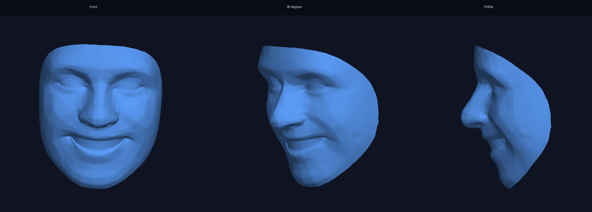

<div align="center">
  
  <h1>3D 人脸识别 / Face3D</h1>
  <p><b>自研 3D 人脸识别框架 + 安卓 APP</b></p>
  <p>Self-developed 3D face recognition framework & Android app</p>
  <p>
    
    
    
    
  </p>
  <p>
    <a href="releases/Face3D-v5.1.0.apk">
      
    </a>
  </p>
</div>

## 项目简介 / Overview

本项目是一套**自研的 3D 人脸识别系统**，包含两部分：

1. **Python 万能接口框架**：一个统一接口，任何识别后端都能作为插件插入，即插即用。
2. **安卓 APP**：真正的 3D 人脸录入与扫描识别，苹果 Face ID 风格的引导与成功动画。

> 架构设计、万能接口、3D 几何特征算法、头部姿态估计、多角度引导采集、人脸库、
> 全部 UI 与 Face ID 动画、交互流程均为本项目自研。所用开源组件的许可证与出处见
> `THIRD_PARTY_NOTICES.md`。

## 功能 / Features

### 安卓 APP（重点）
- **应用图标**：自研设计——人脸 3D 网格 + 扫描取景框 + 识别成功对勾，多分辨率 + 自适应图标
- **极简主界面**：进入即为「录入人脸」「扫描人脸」两个核心入口
- **命名录入**：录入前为每个人输入姓名；按苹果 Face ID 风格**引导缓慢转头**，多角度采集 3D 特征
- **多人人脸库**：可录入多个人，每人保存多个角度的 3D 特征；支持查看与删除
- **扫描识别**：实时 3D 检测，与库内所有人比对，**识别成功后在下方显示此人姓名**
- **苹果 Face ID 动画**：录入分段进度环、扫描旋转光环、成功绿色对勾（带绘制动画+震动）、失败红叉

### Python 万能接口
- 一个 `UniversalFace3D` 接口聚合所有插件，单个插件失败不影响整体
- 内置插件：dlib（检测 / 68 点 / 128D 特征 / 比对）、MediaPipe（478 点 3D 网格 / 表情 / 变换矩阵）
- **自研单目 3D 重建插件**（`monocular3d`）：从**一张普通 2D 照片**重建出完整密集 3D 人脸网格
  （7257 顶点 / 14368 面），可导出 OBJ/PLY、三视角渲染图与可旋转交互页
- 新增实现只需继承 `Face3DProvider` + `@register`，无需改动引擎

### 单目 3D 人脸重建（核心算法，自研）
弥补普通手机没有 3D 结构光 / 3D 摄像头的硬件缺陷——只靠一张 2D 图，用算法恢复完整 3D 人脸表面：

| 步骤 | 做法 |
|------|------|
| 1. 3D 锚点检测 | MediaPipe FaceLandmarker 输出 478 个带 z 深度的 3D 人脸锚点 |
| 2. 拓扑锚定 | 前 468 个锚点与官方 canonical 拓扑的 468 顶点一一对应（边长相关性实测 0.968） |
| 3. 网格形变 | 以鼻尖为原点归一化，把锚点作为形变后顶点，套用 898 个三角面组装完整网格 |
| 4. 密集化 | 重心细分 + 拉普拉斯平滑，得到 7257 顶点 / 14368 面的平滑密集网格 |
| 5. 可视化 | 自研纯软件光栅化渲染（不依赖 WebGL）：正面 / 45° / 侧面三视角，结果确定可信 |



运行：`python examples/reconstruct_demo.py` → 输出在 `python/output/reconstruction/`（OBJ、PLY、三视角 PNG、可旋转 HTML）。

## 目录结构 / Structure

| 目录 | 说明 |
|------|------|
| `android/` | 安卓 APP 完整工程（自研 UI / 动画 / 交互 / 数据层） |
| `android/app/src/main/java/com/example/face3d/` | 自研核心代码：引擎、人脸库、动画、主流程 |
| `python/universal3dface/reconstruction/` | **自研单目 3D 重建算法**：网格拓扑、重建引擎、软件渲染 |
| `python/output/reconstruction/` | 重建演示产物：OBJ/PLY 网格、三视角渲染图 |
| `python/` | 万能接口框架与示例 |
| `docs/` | APK 独立发布页（GitHub Pages） |
| `releases/` | 已构建的 APK 安装包 |

## 快速开始 / Quick Start

### 安装 APP
- **直接安装**：下载 [APK v5.1.0 稳定版](releases/Face3D-v5.1.0.apk)（Android 7.0+，需允许安装未知来源）。录入改为真实逐点扫描：灵动岛先显示人脸轮廓引导，摄像头扫到哪就把那个位置的真实点逐格点亮成高斯斑，转头扫全脸 1000 点才完成；每个亮点都来自真实检测，没有模板脸、没有程序补点。识别简化为扫到即成功，不再展示建立/重建模型的中间过程。人脸库 3D 建模为连续三角网格曲面：用 MediaPipe 官方 898 面拓扑把录入的真实 478 点连成完整人脸表面，带法线光照的灰蓝石膏质感，只表达几何形状、零皮肤纹理（与 SplatFace、MonoGSDF、PRNet 等几何优先分支的裸网格一致），支持触摸旋转；几何全部来自真实录入数据，不是标准脸。沿用心智：高斯光斑汇聚重建、暗光增强识别、单次短震、无黑屏遮罩。
- **源码构建**：Android Studio 打开 `android/`，连接设备运行。

使用步骤：
1. 点「录入人脸」→ 输入姓名 → 按屏幕引导缓慢转头，完成多角度 3D 采集 → 绿色对勾 + 显示姓名
2. 点「扫描人脸」→ 正对镜头 → 识别成功后显示该人的姓名
3. 点「管理」可查看已录入人员或删除

### Python
```bash
cd python
pip install -r requirements.txt
bash download_models.sh
python examples/demo.py
```

## 3D 人脸识别是怎么做到的

- **3D 数据来源**：MediaPipe FaceLandmarker 输出 478 个带 z 深度的 3D 顶点 + 4×4 头部变换矩阵。
- **自研 3D 特征**：以鼻尖为原点、双眼外眼角距离为尺度做归一化，得到对平移/缩放稳定、保留深度的 3D 几何特征向量。
- **多角度采集**：录入时通过头部姿态估计（yaw/pitch）引导用户转头，采集 5 个不同角度的 3D 特征，比单帧更稳健。
- **识别比对**：扫描帧与库内每个人所有角度特征做余弦相似度比对，连续匹配确认后判定成功并显示姓名。

### 技术亮点
- **3D 几何特征比对**：以鼻尖为原点、眼距为尺度归一化，保留 z 深度信息，对平移与缩放稳定。
- **单目 3D 重建**：锚点驱动的标准拓扑形变，配合重心细分与拉普拉斯平滑，从单张照片得到平滑密集人脸网格。
- **纯软件渲染**：自研光栅化渲染器，正面 / 45° / 侧面三视角展示，效果稳定一致。
- **Face ID 交互**：分段进度环、转头引导、成功对勾动画与震动反馈，交互体验贴近系统级人脸识别。

## 许可证 / License

本项目 MIT。底层基础依赖各自遵循原始许可证，详见 `THIRD_PARTY_NOTICES.md`（根目录 / python / android）。
